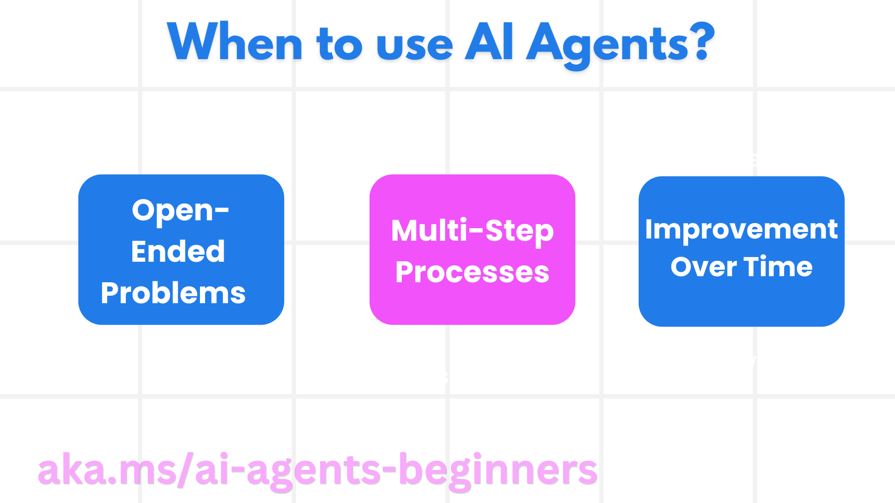
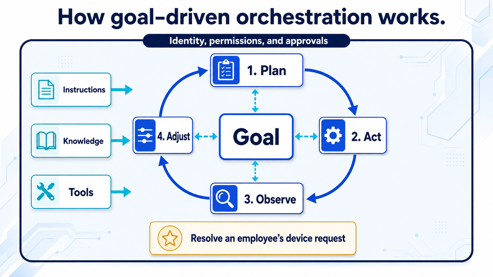

# Mission 01: Understand the agent

<mission-meta />

## Why start with concepts?

An agent is not simply a chat window with a model behind it. Its behavior comes from several parts working together: a model generates and reasons over language; instructions define the role and boundaries; knowledge provides evidence; tools perform operations; and the runtime decides which capability to use next.

This lesson establishes that mental model before you configure the Contoso Workplace Concierge.

## Fixed paths and flexible reasoning

A topic-driven bot follows paths authored in advance. A reasoning-oriented agent receives a goal, instructions, and a set of permitted capabilities, then selects a path based on the request and the results it observes.

| Design | Maker specifies | A good fit |
|---|---|---|
| Authored conversation | Topics, triggers, branches, and messages | Repeatable dialogues where the path should be explicit |
| Reasoning-oriented agent | Purpose, instructions, data, tools, and limits | Requests that vary and require several capabilities |

These approaches are not a maturity ladder. A fixed process may be safer and easier to maintain as a defined flow; an agent may be useful where the next step depends on context. An AI assistant describes how a person uses AI, not necessarily how the underlying system is built.



## Model, instructions, and evidence

Large language models (LLMs) generate text from input and learned patterns. They can help interpret intent and plan, but their training is not a source of current company policy. Their context window is finite, and an answer can be plausible without being supported.

Instructions make the role, scope, tone, and decision boundaries explicit. Prefer operational rules over vague goals: say which sources are authoritative, which actions require confirmation, and what the agent must do when evidence is missing.

Retrieval-augmented generation (RAG) adds relevant material from connected sources to the model's context. A typical grounded response searches a source, uses retrieved evidence, and cites it where the product supports citations. Retrieval is not the same as action: knowledge answers questions; tools read or change systems.

## Harness and orchestration

The **harness** is the runtime surrounding a model. It determines which capabilities and context are available, how execution is managed, and how the model's decisions connect to tools. **Orchestration** is the part that coordinates the next step.

The GitHub Copilot harness used in this course can pursue a goal through an iterative cycle:

```text
plan -> act -> observe -> adjust
```

This is a useful mental model, not a guarantee that every request follows the same number of steps. The builder defines available capabilities and boundaries; the runtime determines how to use them for a given request.



## Let the agent reason; let the workflow execute

An agent can interpret a request, resolve ambiguity, and decide whether it has enough information. A workflow is better suited to a known sequence that should run the same way each time.

In the course scenario, the agent helps an employee find a shared meeting-room accessory or report a workplace issue. After an employee confirms an equipment request, a workflow retrieves the selected SharePoint record and sends a test email to a facilities inbox. Confirm before actions with external effects, use test recipients, and make failure paths visible.

Before connecting any capability, decide whether it should be allowed automatically, require user confirmation, or be handled by a person.

## Where this course fits

Microsoft offers multiple ways to build agents, from lightweight authoring in Microsoft 365 Copilot to Copilot Studio and code-first services such as Microsoft Foundry and the Agents SDK. Choose based on the required control, audience, integrations, and operating model—not on a belief that every scenario needs the most complex platform.

This path uses Microsoft Copilot Studio and the GitHub Copilot harness. Mission 02 compares Copilot Studio build surfaces and harnesses in more detail.

## Checkpoint

Before continuing, make sure you can explain:

- What the model contributes, and why it is not an authoritative policy source by itself.
- How knowledge differs from a tool that performs an action.
- What the harness provides and what orchestration coordinates.
- Why a repeatable transaction can be safer as a workflow than as an unconstrained agent action.

## Mission complete

You have the vocabulary to reason about the system you will build. Continue to [Copilot Studio Fundamentals](../02-copilot-studio-fundamentals/index.md).

## References

- [AI Agents for Beginners](https://github.com/microsoft/ai-agents-for-beginners)
- [Copilot Studio documentation](https://learn.microsoft.com/microsoft-copilot-studio/)
- [Choose a harness in Copilot Studio](https://learn.microsoft.com/en-us/microsoft-copilot-studio/harnesses-overview)

<analytics-tag section="recruit-nextgen" mission="01-introduction-to-agents" />
