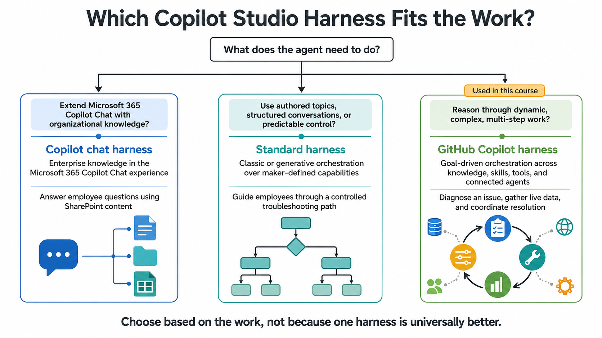

# Mission 02: Choose the right Copilot Studio surface

<mission-meta />

## Copilot Studio in the Microsoft stack

Microsoft Copilot Studio is a platform for authoring, testing, publishing, and monitoring agents. It connects agent experiences to Power Platform environments, solutions, connectors, and knowledge sources. The appropriate design depends on the task, intended audience, and governance requirements.

For a focused agent over Microsoft 365 content, Agent Builder may be enough. Use Copilot Studio when the scenario calls for richer integrations, workflows, channel choices, or lifecycle management. Consider code-first options when the application needs custom control of its runtime, orchestration, or infrastructure.

| Surface | Typical approach | Consider it for |
|---|---|---|
| Agent Builder in Microsoft 365 Copilot | Natural-language, no-code | A focused agent for a person or team |
| Copilot Studio | Low-code with extensible integrations | Business agents with tools, workflows, and managed deployment |
| Microsoft Foundry and developer SDKs | Code-first | Custom applications and control over implementation |

This course uses Copilot Studio. The GitHub Copilot harness is the runtime for the agent, not the GitHub Copilot coding assistant. It does not require a GitHub subscription.

## Compare the Copilot Studio harnesses

Copilot Studio offers different harnesses for different experiences. Verify current features and licensing in Microsoft's documentation because product capabilities evolve.

| Harness | Design emphasis | Typical fit |
|---|---|---|
| Copilot chat | Extend Microsoft 365 Copilot Chat with organizational context | Internal knowledge experiences |
| Standard | Topics, authored paths, and maker-configured capabilities | Structured conversations and explicit control |
| GitHub Copilot | Goal-driven reasoning over agent capabilities | Ambiguous or multi-step tasks |

The standard harness can also use generative orchestration; the distinction is not simply “AI versus no AI.” Compare the runtime, capabilities, governance, channel needs, and billing for the actual scenario.

The **Contoso Workplace Concierge** is a learning example for the GitHub Copilot harness: it interprets a facilities request, searches approved workplace guidance, reads shared-equipment options, and invokes a workflow only after confirmation.

## Agent building blocks

On the GitHub Copilot harness, the agent’s behavior comes from its configuration and the capabilities made available to it:

- **Instructions** define role, scope, response style, safety rules, and escalation behavior.
- **Knowledge** grounds answers in configured sources. Check permissions and citations; retrieved content can be incomplete or stale.
- **Memory** can retain relevant context across tasks, subject to the product configuration and organizational controls.
- **Tools** connect the agent to actions such as reading SharePoint records or calling a workflow. Keep scope narrow and descriptions specific.
- **Skills** package reusable, task-specific procedures. This course uses skills for facilities issue triage and equipment requests.
- **Models** affect reasoning, latency, capability, and cost. Select for the workload and evaluate alternatives.
- **Connected agents** allow delegation to specialized agents where supported and justified.

Workflows are related automations, not a substitute for the agent's instructions. A workflow can run as a tool called by an agent; it can also include an AI step where the process requires judgment. Keep deterministic steps deterministic.

## How to guide orchestration

When a capability is not selected reliably, do not immediately add more instructions. Inspect the trace and ask:

1. Does the agent understand the goal and its boundary?
2. Is the tool or skill named and described in terms of the user task?
3. Are its inputs constrained to the intended site, list, and operation?
4. Is there an overlapping capability that creates ambiguity?
5. Does the Preview test use a new conversation and the saved configuration?

Use Preview and evaluation features to assess behavior; a single successful conversation is not proof of reliability.

## Decide what should be predictable

Use agent reasoning when the correct next step depends on the user's intent or retrieved evidence. Use a workflow when a known sequence must execute consistently, such as retrieving a selected equipment record and notifying a test facilities inbox. For consequential actions, require confirmation and provide a clear failure path.

## Checkpoint

You should now be able to distinguish the Copilot Studio harness options and describe the purpose of instructions, knowledge, tools, skills, models, and workflows. Continue with [Creating a Solution](../03-creating-a-solution/index.md).

## References

- [Choose a harness](https://learn.microsoft.com/en-us/microsoft-copilot-studio/harnesses-overview)
- [GitHub Copilot harness overview](https://learn.microsoft.com/en-us/microsoft-copilot-studio/agents-experience/overview)
- [Agent design framework](https://learn.microsoft.com/en-us/microsoft-copilot-studio/guidance/agent-design-canvas-framework)
- [Declarative Agent Foundation with Agent Builder](https://microsoft.github.io/copilot-camp/pages/extend-m365-copilot/01-first-agent-builder/)

<analytics-tag section="recruit-nextgen" mission="02-copilot-studio-fundamentals" />
